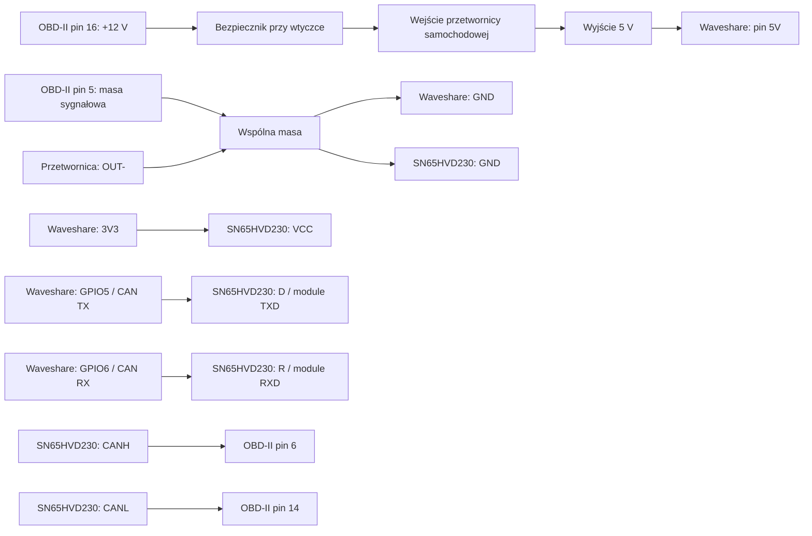

# Referencja sprzętowa: Waveshare ESP32-S3-Touch-AMOLED-1.64

Główne źródło: [dokumentacja Waveshare](https://docs.waveshare.com/ESP32-S3-Touch-AMOLED-1.64)

## Dane istotne dla konfiguracji ESPHome

- Mikrokontroler: ESP32-S3R8; pamięć Flash 16 MB i PSRAM 8 MB.
- Ekran: AMOLED 1,64 cala, CO5300, 280 × 456 pikseli, interfejs QSPI.
- Dotyk: pojemnościowy FT3168, interfejs I²C.
- IMU: QMI8658C, I²C, adres 7-bitowy `0x6B`.
- Płytka występuje w rewizjach V1 i V1.1. Waveshare podaje, że nadruk wersji V1 znajduje się przy górnej krawędzi PCB, a V1.1 po prawej stronie, w pobliżu wyprowadzeń pinów. Oferta Gotronik dla SKU 31197 potwierdza model płytki, ale nie wskazuje rewizji; rozstrzygający będzie nadruk na egzemplarzu, nie zdjęcie produktu. [Dokumentacja Waveshare — identyfikacja rewizji](https://docs.waveshare.com/ESP32-S3-Touch-AMOLED-1.64)
- Według tabeli Waveshare pin `LCD_CS` to GPIO9 w V1 i GPIO46 w V1.1; w tych rewizjach różnią się też piny przerwań IMU. V1.1 dodaje między innymi przerwanie dotyku `TP_INT` na GPIO18.
- Oferta Gotronik dla SKU 31197 potwierdza model płytki, ale nie wskazuje rewizji; zdjęcia produktu nie są wystarczającym dowodem, by wybrać wariant firmware. Jeśli nadruk rewizji jest nieczytelny, schematy Waveshare pokazują też różnicę w diodach: V1 ma zwykłe diody SMD 0402, a V1.1 diody boczne (side-emitting) 0602. To pomocna wskazówka wizualna, ale przy niepewności potwierdź rewizję po oznaczeniu PCB lub dopiero na fizycznej płytce.
- ESPHome zgłasza GPIO46 jako pin strapujący ESP32-S3. W V1.1 jest on już używany przez Waveshare jako `LCD_CS`; pozostaw to połączenie zgodnie z płytką i nie dołączaj do GPIO46 zewnętrznego transceivera ani dodatkowych rezystorów podciągających/ściągających.

## USB, logi szeregowe i test zasilania

Złącze USB-C tej płytki korzysta z natywnego USB ESP32-S3, a nie z osobnego mostka USB-UART. Dokumentacja Waveshare opisuje interfejs jako natywne USB; schemat V1 prowadzi linie D-/D+ przez rezystory 22 Ω do GPIO19/GPIO20 układu ESP32-S3. Bieżący firmware kieruje logi ESPHome przez USB Serial/JTAG. [Dokumentacja Waveshare: Arduino i USB](https://docs.waveshare.com/ESP32-S3-Touch-AMOLED-1.64/Arduino), [schemat V1](https://files.waveshare.com/wiki/ESP32-S3-Touch-AMOLED-1.64/ESP32-S3-Touch-AMOLED-1.64-schematic.pdf).

Podłączenie do komputera różni się więc od powerbanku w dwóch rzeczach naraz: źródle 5 V oraz obecności hosta na liniach USB. Sama obserwacja „stabilny na powerbanku, śnieży na komputerze” nie rozstrzyga, czy problem dotyczy zasilania, USB Serial/JTAG czy współdziałania interfejsów. Do rozdzielenia tych przyczyn użyj potwierdzonego firmware CAN-off i bez transceivera: porównaj pracę z zasilaniem komputera przez adapter blokujący dane USB oraz bezpośrednio z komputera. Jeśli objaw podąża za liniami danych, trop prowadzi do natywnego USB/logowania; jeśli występuje także bez nich, sprawdź spadek lub zakłócenia 5 V i tor wyświetlacza. Nie zmieniaj jasności ani firmware pomiędzy próbami.

## Połączenia monitora DPF

Czytelny schemat przewód-po-przewodzie: [`schemat-polaczen-dpf.svg`](schemat-polaczen-dpf.svg).

Aktywna konfiguracja odczytuje standardowe PID OBD-II oraz częściowy profil UDS CJCD. Alarm jest szacowany z EGT3, a statusy regeneracji ECU pozostają niepotwierdzone. [Aktualne mapowania](PARAMETER_REFERENCE.md) określają zakres; nie przenoś DID do innego ECU na podstawie samego kodu silnika.

Do budowy potrzebujesz Waveshare ESP32-S3-Touch-AMOLED-1.64, zewnętrznego SN65HVD230 3,3 V, wtyku OBD-II, zabezpieczonego samochodowego toru zasilania 5 V, przewodów i obudowy z odciążeniem kabla. Kontroler TWAI ESP32 nie zastępuje transceivera. Projekt nie zawiera zweryfikowanej produkcyjnej płytki ochronnej zasilania.

CAN: GPIO5 TX → wejście D/TXD, GPIO6 RX ← wyjście R/RXD. GPIO1 jest zajęte przez enable wyświetlacza. GPIO5/6 współdzielą połączenia TF — wyjmij microSD podczas pracy CAN. Oznaczenia TX/RX modułu dotyczą jego D/R; nie krzyżuj wyjść dwóch urządzeń.

| Złącze / moduł | Połącz z | Uwagi |
|---|---|---|
| OBD-II pin 16 | wejście `IN+` samochodowego toru zasilania | Zasilanie samochodu; w szereg daj bezpiecznik przy wtyczce, przed przetwornicą. |
| OBD-II pin 5 | wejście `IN-` przetwornicy | Masa sygnałowa i odniesienie dla transceivera; pin 5 może też służyć jako masa zasilania testera diagnostycznego. |
| Przetwornica `OUT+` 5 V | pin `5V` płytki Waveshare | Sprawdź miernikiem 5 V przed podłączeniem płytki. Przetwornica i jej zabezpieczenia muszą być przeznaczone do instalacji samochodowej. |
| Przetwornica `OUT-` | `GND` płytki | Wspólna masa układu. |
| Płytka `3V3` | `VCC` SN65HVD230 | Moduł SN65HVD230 wymaga 3,3 V; nie podawaj na niego 5 V. |
| Płytka `GND` | `GND` SN65HVD230 | Wspólna masa logiki i CAN. |
| GPIO5 (`canbus.tx_pin`) | wejście `D` układu SN65HVD230 — na module może być opisane `TX`, `TXD` lub `CAN TX` | Nadajnik ESP32 → transceiver; pozostaw gniazdo TF bez karty. |
| GPIO6 (`canbus.rx_pin`) | wyjście `R` układu SN65HVD230 — na module może być opisane `RX`, `RXD` lub `CAN RX` | Odbiornik transceivera → ESP32; pozostaw gniazdo TF bez karty. |
| SN65HVD230 `CANH` | OBD-II pin 6 | CAN High. |
| SN65HVD230 `CANL` | OBD-II pin 14 | CAN Low. |

Nie podłączaj 12 V z pinu OBD-II 16 do płytki ESP32 ani modułu SN65HVD230. Nie zwieraj CANH z CANL i nie dodawaj terminatora 120 Ω bez potwierdzenia, że jest wymagany. Pin 4 złącza jest masą nadwozia, a pin 5 masą sygnałową; SAE J1962 dopuszcza również wykorzystanie pinu 5 jako powrotu zasilania testera diagnostycznego. Dlatego schemat używa pinu 5 jako `IN-` przetwornicy i wspólnego odniesienia dla transceivera. Nie łącz dodatkowo pinów 4 i 5 bez potrzeby. Pin 16 OBD-II może być zasilany stale, więc urządzenie może pobierać prąd po wyłączeniu auta; na czas postoju odłącz je albo zapewnij kontrolowane wyłączanie.

Zwykły moduł step-down opisany tylko jako „12 V → 5 V” nie jest automatycznie odpowiedni do auta. Użyj kompletnego samochodowego modułu albo dodaj zaprojektowany dla niego tor ochronny. Dokumentacja konkretnego modułu powinna potwierdzać zakres wejściowy i ochronę przed przepięciami/transientami (w tym load dump), odwrotną polaryzacją oraz spadkiem napięcia przy rozruchu. Nie dobieraj samej diody TVS na podstawie ogólnej porady: jej napięcie ograniczania musi pasować do przetwornicy i instalacji. Referencyjny projekt TI dla wejścia akumulatorowego 12/24 V wymienia ochronę przed load dump, nadnapięciem, przeciążeniem i odwrotną polaryzacją; wymagania zależą od konkretnej topologii i poziomu ochrony pojazdu. [TI TIDA-01167](https://www.ti.com/tool/TIDA-01167), [SAE J1962, sekcja 6.3.4 (PDF)](https://law.resource.org/pub/us/cfr/ibr/005/sae.j1962.2002.pdf)

Waveshare podaje dla modułu SN65HVD230 zasilanie `3.3 V`, ochronę ESD i szybkość magistrali do `1 Mbps`; konfiguracja monitora używa `500 kbps`, czyli mieści się w podanym limicie. Na układzie scalonym wejście nadajnika to `D`, a wyjście odbiornika `R`; oznaczenia na złączu gotowego modułu mogą używać nazw `TXD`/`RXD` albo `CAN TX`/`CAN RX`. Kieruj się nadrukiem konkretnego modułu, nie samą kolejnością pinów. Sprawdź również oznaczenie układu oraz pin `RS`: w SN65HVD230 stan wysoki włącza standby nadajnika, ale odbiornik pozostaje aktywny, więc ten stan blokowałby wysyłanie żądań, ale sam nie tłumaczyłby `RX=0`. Dla SN65HVD231 stan wysoki wyłącza także odbiornik i mógłby wyjaśnić brak odbioru. Nie zakładaj, że klon z innym oznaczeniem zachowuje się identycznie; przed zmianą połączeń ustal model układu i stan RS. Ochrona ESD transceivera nie zastępuje przetwornicy z wejścia samochodowego ani ochrony toru zasilania z pinu OBD-II 16. [Specyfikacja modułu SN65HVD230 CAN Board](https://www.waveshare.com/product/sn65hvd230-can-board.htm), [FAQ Waveshare: szybkość transmisji](https://www.waveshare.com/wiki/SN65HVD230_CAN_Board), [opis pinów D/R producenta](https://www.waveshare.com/wiki/RS485_CAN_Shield), [nota katalogowa TI: tryby RS SN65HVD230/231](https://files.waveshare.com/upload/3/3a/SN65HVD230-CAN-Board-Datasheets.pdf).

## Uwagi do bieżącego YAML

- YAML jawnie ustawia `esp32.flash_size: 16MB`. Sama nazwa ogólnej definicji płytki `esp32-s3-devkitc1-n16r8` nie wystarczyła: ESPHome 2026.9.1 domyślnie generowało konfigurację z 4 MB Flash, mimo że Waveshare podaje 16 MB Flash i 8 MB PSRAM. Jawny rozmiar pozwala generatorowi ESPHome dobrać większe sloty OTA.
- `display_cs_pin` w bieżącym firmware wynosi GPIO9. Oznaczenie rewizji na płytce użytkownika jest nieczytelne, dlatego na jego prośbę przyjmujemy roboczo V1. Skrypt kompiluje wyłącznie ten wariant; starszy obraz V1.1 nie jest przeznaczony do tej płytki.
- Sam numer SKU 31197 na stronie sprzedawcy nie rozstrzyga rewizji. Najpierw sprawdź nadruk na PCB; typ diod może pomóc ją rozpoznać, gdy nadruk nie jest widoczny. Nie dobieraj firmware wyłącznie na podstawie zdjęć aukcyjnych.
- Dla V1.1 walidacja ESPHome może wypisać ostrzeżenie o GPIO46 jako pinie strapującym. To ten sam pin, którego Waveshare używa jako `LCD_CS`; nie przenoś na niego połączeń CAN ani dodatkowego obciążenia.
- CAN w bieżącym YAML używa GPIO5 (TX) i GPIO6 (RX). GPIO1 jest zarezerwowane w prespecie aktywnego wyświetlacza jako `enable_pin`. GPIO5/6 współdzielą ścieżki z gniazdem TF, więc podczas pracy monitora nie używaj karty microSD.
- Dokumentacja Waveshare wymienia kontroler dotyku FT3168. Bieżący YAML korzysta z lokalnego komponentu `components/ft3168/touchscreen`; adres I²C to `0x38`. Odczyt rejestru trybu `0x00`, liczby dotknięć `0x02` i współrzędnych `0x03`, sposób rozpakowania X/Y oraz ograniczenie do rozdzielczości ekranu porównałem z [oficjalnym przykładem Waveshare dla V1.1](https://github.com/waveshareteam/ESP32-S3-Touch-AMOLED-1.64-v2/blob/main/Arduino/examples/06_LVGL_Test/FT3168.cpp). Fizyczne działanie dotyku i jego trafianie po obrocie LVGL nadal wymagają testu na płytce; konfiguracja nie używa pinu przerwania FT3168.
- Parametry ekranu i płytki w tym dokumencie pochodzą z dokumentacji producenta; wartości DID i ich skale dla ECU Audi wymagają osobnego potwierdzenia diagnostycznego. Zasady tworzenia profili i rozróżnienie etykiet IDE od surowych DID-ów opisuje `DPF_PROFILES.md`.
